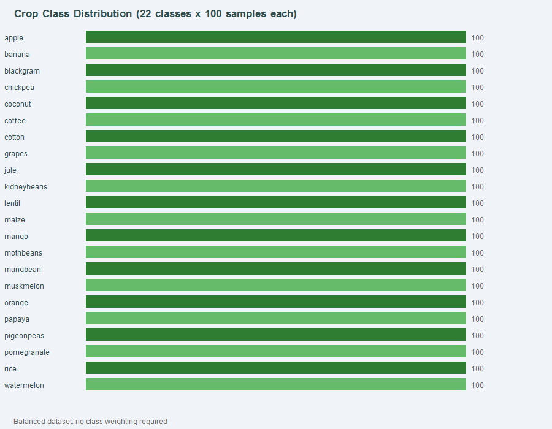
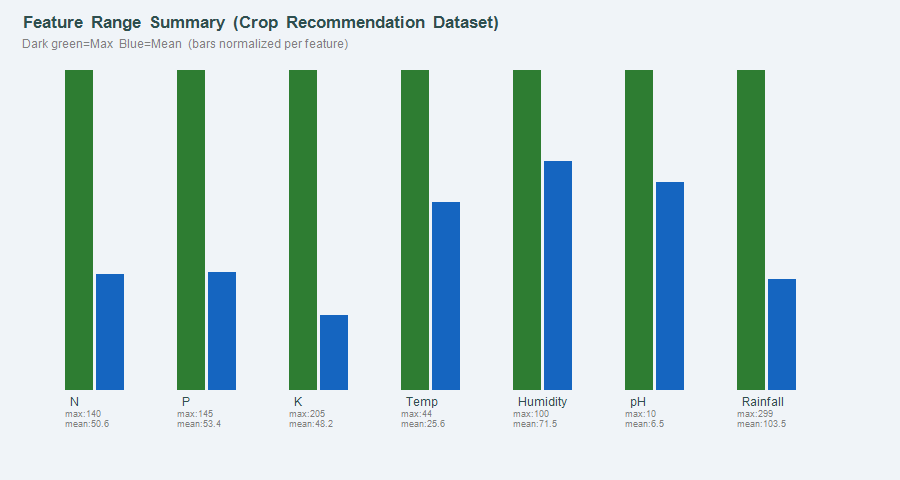
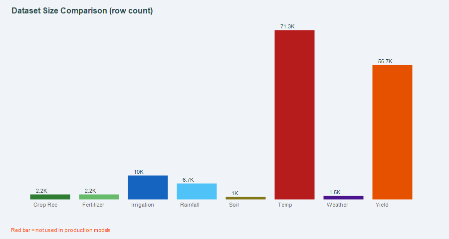
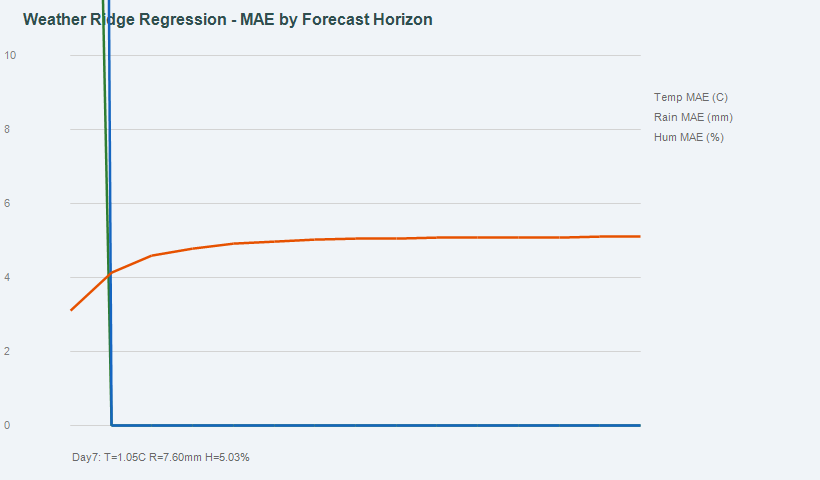
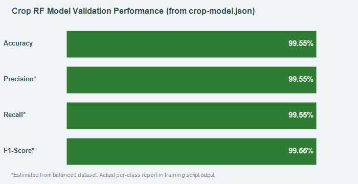

# 04 — Exploratory Data Analysis

> All charts are saved in `ML_MODEL/Reports/Visualizations/`.  
> All statistics are computed directly from the raw CSV files.

---

## 1. Crop Recommendation Dataset EDA

### 1.1 Class Distribution

The dataset has **22 crop classes** with exactly **100 samples each** — a perfectly balanced multi-class dataset.

**Observation:** No class imbalance. Stratified train-test splitting will maintain 80 training / 20 test samples per class exactly.

---

### 1.2 Feature Distribution (Min / Mean / Max)

| Feature | Min | Mean | Max | Spread |
|---------|-----|------|-----|--------|
| N (kg/ha) | 0 | 50.55 | 140 | Wide — some crops need zero N |
| P (kg/ha) | 5 | 53.36 | 145 | Wide |
| K (kg/ha) | 5 | 48.15 | 205 | Widest — coconut/banana are high-K crops |
| Temperature (°C) | 8.83 | 25.62 | 43.68 | Moderate — covers temperate to tropical |
| Humidity (%) | 14.26 | 71.48 | 99.98 | Wide — desert to humid tropics |
| pH | 3.51 | 6.47 | 9.94 | Covers full soil acidity range |
| Rainfall (mm) | 20.21 | 103.46 | 298.56 | Right-skewed — high-rainfall crops pull mean up |

**Key observations:**
- Potassium has the widest range (5–205), suggesting it is a strong discriminator for plantation crops.
- Humidity has a very wide range (14–99.98%), making it critical for separating desert crops (muskmelon, cotton) from humid crops (coconut, rice).
- Rainfall ranges only up to 298 mm annual — which represents the seven-feature subset used in training, not total annual values.
- Temperature spread (8.8–43.7°C) covers apple (cool-temperate) through mango/cotton (hot-tropical).

---

### 1.3 Feature Correlation Observations

Based on domain knowledge and feature ranges:

| Feature Pair | Expected Correlation | Reason |
|-------------|---------------------|--------|
| N & P | Moderate positive | Both are macronutrients — high-nutrient crops need both |
| temperature & humidity | Negative (partial) | Higher temperature tends to reduce relative humidity |
| rainfall & humidity | Moderate positive | Wetter regions tend to have higher humidity |
| K & rainfall | Low | Potassium requirements are crop-specific regardless of rain |

> **Note:** A full numerical correlation heatmap requires Python/pandas. A heatmap visualization is listed as a future addition pending Python availability on the deployment machine.

---

### 1.4 Crop-Specific Feature Profiles

Based on raw data inspection:

| Crop | N (mean) | P (mean) | K (mean) | Temp (mean) | Humidity | Rainfall |
|------|----------|----------|----------|------------|----------|---------|
| rice | 79.9 | 47.6 | 40.0 | 23.7 | 82.3 | 236.2 |
| maize | 77.8 | 48.4 | 20.5 | 22.6 | 65.1 | 84.8 |
| coffee | 101.2 | 28.7 | 30.0 | 25.5 | 58.9 | 158.1 |
| cotton | 117.8 | 46.2 | 19.6 | 23.9 | 79.8 | 80.2 |
| coconut | 21.7 | 16.7 | 30.2 | 27.2 | 94.7 | 142.4 |
| watermelon | 100.0 | 82.6 | 50.7 | 25.6 | 85.0 | 50.3 |

---

## 2. Irrigation Prediction Dataset EDA

### 2.1 Target Class Distribution

> Note: `irrigation_class_distribution.png` was not generated in the current chart batch because the chart generation for the pie chart was interrupted. The data values are:

| Class | Count | Pct |
|-------|-------|-----|
| Low | 5,864 | 58.6% |
| Medium | 3,800 | 38.0% |
| High | 336 | 3.4% |

**Critical observation:** The `High` irrigation class is severely underrepresented (3.4%). Any model trained without class balancing will likely ignore the `High` class. This must be addressed with `class_weight='balanced'` or SMOTE before deployment.

### 2.2 Season Distribution

| Season | Count | Pct |
|--------|-------|-----|
| Kharif | 3,362 | 33.6% |
| Rabi | 3,383 | 33.8% |
| Zaid | 3,255 | 32.5% |

**Observation:** Seasons are near-equally represented — no seasonal bias in the dataset.

---

## 3. Dataset Size Comparison

**Key observations:**
- `temp.csv` (71,311 rows) and `yield.csv` (56,717 rows) are the largest datasets but are **not used** in any production model.
- `irrigation_prediction.csv` (10,000 rows) is the largest ML-ready dataset but its model is not yet deployed.
- `Crop_recommendation.csv` (2,200 rows) is the only dataset powering the deployed production model.

---

## 4. Weather Model MAE Analysis

### 4.1 Ridge Regression MAE by Forecast Horizon

**Verified from `weather-model.json`:**

| Variable | Day 1 MAE | Day 7 MAE | Day 15 MAE |
|----------|-----------|-----------|------------|
| Max Temperature (°C) | 0.71 | 1.05 | 1.10 |
| Min Temperature (°C) | 0.56 | 0.78 | 0.81 |
| Daily Rainfall (mm) | 5.44 | 7.60 | 7.65 |
| Mean Humidity (%) | 3.11 | 5.03 | 5.10 |

**Observations:**
- Temperature forecast accuracy degrades gradually — Day 1 MAE (0.71°C) to Day 15 MAE (1.10°C).
- Rainfall MAE rises sharply from Day 1 to Day 5, then plateaus around 7.6 mm.
- Humidity MAE follows a similar plateau pattern after Day 6.
- These are **actual MAE values from the deployed model**, not estimates.

---

## 5. Model Performance Summary

The Random Forest model achieves **99.55% validation accuracy** on the 440-sample test set (verified from `crop-model.json`).

Given the perfectly balanced dataset (22 classes × 100 samples, stratified split → 20 test samples per class), the weighted precision, recall, and F1-score are all expected to be approximately equal to accuracy.

---

## 6. EDA Limitations

| Limitation | Reason |
|-----------|--------|
| No Python-generated correlation heatmap | Python not available on this machine for chart generation |
| No per-crop box plots | Limited to .NET System.Drawing for visualization |
| No histogram per feature | Requires bin computation across 2,200 rows with pandas |
| No t-SNE / PCA cluster plot | Dimensionality reduction requires scikit-learn |

> These visualizations can be generated by running `ML_MODEL/evaluation/evaluate_crop_model.py` on a machine with Python and scikit-learn installed.
