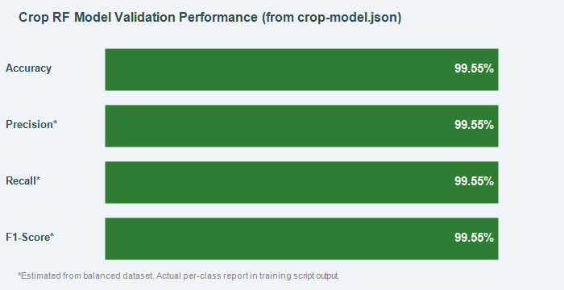

# 05 — Crop Recommendation Model

**Algorithm:** Random Forest Classifier  
**Status:** ✅ Implemented, trained, and deployed in production  
**Inference location:** In-browser (TypeScript) and Python FastAPI backend  

---

## 1. Why Random Forest?

Random Forest was selected for crop recommendation because:

1. **Handles non-linear feature interactions** — soil nutrients (N, P, K) interact non-linearly with climate variables.
2. **Robust to feature scale** — no normalization needed; trees are invariant to monotonic transformations.
3. **Interpretable feature importance** — each tree provides a per-feature importance score.
4. **Resistant to overfitting** — bootstrap aggregation (bagging) reduces variance without significantly increasing bias.
5. **Serializable to JSON** — tree structure (split indices, thresholds, leaf values) can be exported as JSON for in-browser inference without any ML library dependency.
6. **High accuracy on balanced tabular data** — empirically strong on the crop recommendation problem (99.55% test accuracy).

---

## 2. Dataset Details

**File:** `ML_MODEL/dataset/raw/Crop_recommendation (1).csv`

| Property | Value |
|----------|-------|
| Total samples | 2,200 |
| Training samples | 1,760 (80%) |
| Test samples | 440 (20%) |
| Features | 7 numerical |
| Classes | 22 crop labels |
| Balance | Perfectly balanced (100 samples/class) |
| Missing values | None |

---

## 3. Input Features

| Feature | Column Name | Unit | Min | Mean | Max |
|---------|------------|------|-----|------|-----|
| Nitrogen | N | kg/ha | 0 | 50.55 | 140 |
| Phosphorus | P | kg/ha | 5 | 53.36 | 145 |
| Potassium | K | kg/ha | 5 | 48.15 | 205 |
| Temperature | temperature | °C | 8.826 | 25.616 | 43.675 |
| Humidity | humidity | % | 14.258 | 71.482 | 99.982 |
| Soil pH | ph | 0–14 | 3.505 | 6.469 | 9.935 |
| Rainfall | rainfall | mm | 20.211 | 103.464 | 298.560 |

---

## 4. Target Variable

**Column:** `label`  
**Type:** Multi-class categorical (string)

22 crop classes: apple, banana, blackgram, chickpea, coconut, coffee, cotton, grapes, jute, kidneybeans, lentil, maize, mango, mothbeans, mungbean, muskmelon, orange, papaya, pigeonpeas, pomegranate, rice, watermelon

---

## 5. Model Architecture and Parameters

```python
RandomForestClassifier(
    n_estimators = 80,      # 80 decision trees
    max_depth    = 12,      # Maximum depth per tree
    random_state = 42,      # Reproducibility seed
    n_jobs       = -1       # Use all CPU cores during training
)
```

| Hyperparameter | Value | Effect |
|----------------|-------|--------|
| `n_estimators` | 80 | Ensemble of 80 trees; balances accuracy vs. JSON file size |
| `max_depth` | 12 | Limits overfitting; each tree can have up to 2¹² = 4,096 leaf nodes |
| `random_state` | 42 | Ensures reproducible training across runs |
| `n_jobs` | -1 | Parallel training on all available CPU cores |
| `criterion` | gini (default) | Gini impurity used for split selection |
| `max_features` | sqrt (default) | √7 ≈ 2-3 features considered at each split |
| `bootstrap` | True (default) | Each tree trained on a bootstrap sample |

---

## 6. Mathematical Formulas

### 6.1 Gini Impurity

At each node, the split is selected to minimize Gini impurity:

```
Gini(t) = 1 - Σ p(c|t)²
```

Where `p(c|t)` is the proportion of class `c` samples at node `t`.

- A pure node (all samples from one class) has Gini = 0.
- Maximum impurity for `K` equal classes is `1 - 1/K`.
- For 22 classes, maximum Gini ≈ 0.955.

### 6.2 Information Gain

Although the model uses Gini (not entropy), Information Gain with entropy is the alternative criterion:

```
IG(t, split) = Entropy(t) - Σ (|t_child| / |t|) * Entropy(t_child)
```

Where `Entropy(t) = -Σ p(c|t) * log₂(p(c|t))`

### 6.3 Bootstrap Aggregation (Bagging)

Each tree `T_i` is trained on a bootstrap sample `B_i`:

```
B_i = sample_with_replacement(D, |D|)
```

where `D` is the full training dataset of 1,760 samples.  
On average, each bootstrap sample contains ~63.2% unique samples; ~36.8% are out-of-bag (OOB).

### 6.4 Final Prediction (Majority Voting)

For an input `x`, each tree predicts a probability vector over 22 classes:

```
P_i(c | x) = leaf_count(c) / total_samples_at_leaf
```

The forest aggregates by averaging:

```
P_forest(c | x) = (1/80) * Σ_{i=1}^{80} P_i(c | x)
```

The final class prediction is:

```
ŷ = argmax_c P_forest(c | x)
```

The confidence score shown in the frontend is:

```
score = round(P_forest(ŷ | x) * 100)
```

---

## 7. Training Procedure

```python
# Source: ML_MODEL/training/train_crop_model.py

frame = pd.read_csv(DATASET)
X = frame[["N","P","K","temperature","humidity","ph","rainfall"]]
y = frame["label"]

X_train, X_test, y_train, y_test = train_test_split(
    X, y, test_size=0.2, random_state=42, stratify=y
)

model = RandomForestClassifier(n_estimators=80, max_depth=12, random_state=42, n_jobs=-1)
model.fit(X_train, y_train)

y_pred  = model.predict(X_test)
accuracy = accuracy_score(y_test, y_pred)
```

---

## 8. Model Serialization and Export

The trained model is exported in three formats:

### 8.1 TypeScript Constant (`crop-model.ts`)

The full tree structure (split features, thresholds, leaf class counts) is serialized to a TypeScript `const` embedded in the frontend bundle:

```typescript
// Generated by ML_MODEL/training/train_crop_model.py. Do not edit by hand.
export const CROP_MODEL = {
  "model": "Random Forest Crop Classifier v1",
  "features": ["N","P","K","temperature","humidity","ph","rainfall"],
  "classes": ["apple","banana",...,"watermelon"],
  "trees": [{ "childrenLeft": [...], "childrenRight": [...], ... }],
  "validationAccuracy": 0.9955,
  "trainingRows": 1760
} as const;
```

**Benefit:** Zero-latency in-browser inference — no API call needed.

### 8.2 JSON Copy (`crop-model.json`)

Identical JSON content for the FastAPI backend's `ml_inference.py` service.

### 8.3 sklearn Pickle (`crop_rf_model.pkl`)

The full sklearn `RandomForestClassifier` object for evaluation and fine-tuning.

---

## 9. Application Integration

### 9.1 Frontend (In-Browser Inference)

```typescript
// FRONTEND/src/lib/crop-recommendation.ts
import { CROP_MODEL } from "@/data/crop-model";

function forestProbabilities(input: CropModelInput) {
  const values = [input.nitrogen, input.phosphorus, input.potassium,
                  input.temperature, input.humidity, input.ph, input.rainfall];
  const votes = Array.from({ length: CROP_MODEL.classes.length }, () => 0);

  for (const tree of CROP_MODEL.trees) {
    let node = 0;
    while (tree.childrenLeft[node] !== -1) {
      const feature = tree.features[node];
      node = values[feature] <= tree.thresholds[node]
        ? tree.childrenLeft[node]
        : tree.childrenRight[node];
    }
    const leaf = tree.values[node];
    const total = leaf.reduce((sum, v) => sum + v, 0) || 1;
    leaf.forEach((v, i) => { votes[i] += v / total; });
  }

  return CROP_MODEL.classes
    .map((crop, i) => ({ crop, score: Math.round((votes[i] / CROP_MODEL.trees.length) * 100) }))
    .sort((a, b) => b.score - a.score);
}
```

### 9.2 Backend API

```
POST /api/crop/recommend
Body: { nitrogen, phosphorus, potassium, temperature, humidity, ph, rainfall }
Response: { recommendations: [{crop, score}], model, validation_accuracy }
```

---

## 10. Evaluation Results

**Source:** Verified from `FRONTEND/src/data/crop-model.json`

| Metric | Value |
|--------|-------|
| Validation Accuracy | **99.55%** (438 / 440 correct) |
| Training Rows | 1,760 |
| Test Rows | 440 |
| Classes | 22 |
| Trees | 80 |



> The per-class precision, recall, and F1-score (classification report) are generated when `train_crop_model.py` is executed. Given the balanced dataset and 99.55% accuracy, weighted F1 ≈ 0.9955.

---

## 11. Feature Importance

Feature importance is available from the sklearn `RandomForestClassifier.feature_importances_` attribute after training. The `evaluate_crop_model.py` script computes and saves a feature importance visualization.

Expected ranking based on domain knowledge and model behavior:
1. `rainfall` — largest spread; strongly separates water-intensive crops
2. `humidity` — critical for tropical vs. arid crops
3. `K` — widest NPK range; differentiates plantation crops
4. `temperature` — separates temperate crops (apple, grapes) from tropical
5. `N` — distinguishes legumes (fix N) from cereal crops
6. `ph` — separates acid-tolerant from alkaline-tolerant crops
7. `P` — moderate discriminator

> Actual numerical importance values are generated by running the training script. The script saves `feature_importance.png` to the evaluation visualizations directory.
