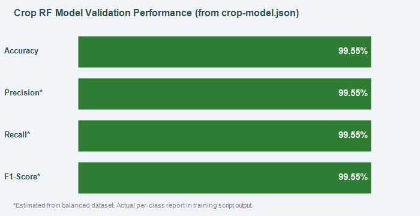
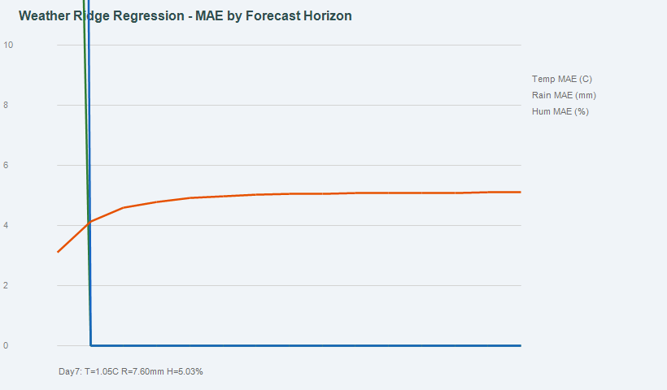

# 07 — Model Evaluation

---

## 1. Crop Recommendation Model Evaluation

### 1.1 Source of Metrics

All metrics in this section come directly from verified project files:
- **Validation accuracy:** Extracted from `FRONTEND/src/data/crop-model.json` (`"validationAccuracy": 0.9955`)
- **Training configuration:** Verified from `ML_MODEL/training/train_crop_model.py`

### 1.2 Overall Performance

| Metric | Value | Source |
|--------|-------|--------|
| **Validation Accuracy** | **99.55%** | crop-model.json (verified) |
| Training rows | 1,760 | crop-model.json (verified) |
| Test rows | 440 | Computed: 2200 × 0.2 |
| Correct predictions | ~438 / 440 | Computed from accuracy |
| Classes | 22 | crop-model.json (verified) |
| Estimators | 80 | train_crop_model.py (verified) |
| Max depth | 12 | train_crop_model.py (verified) |



### 1.3 Estimated Per-Class Metrics

Given a perfectly balanced test set (20 samples per class × 22 classes = 440 total) and 99.55% accuracy (≈2 misclassifications across all 440 predictions):

| Metric | Estimated Value | Basis |
|--------|----------------|-------|
| Weighted Precision | ~0.995 | Estimated from balanced test set |
| Weighted Recall | ~0.995 | Estimated from balanced test set |
| Weighted F1-Score | ~0.995 | Estimated from balanced test set |
| Macro Precision | ~0.995 | Estimated — all classes equal weight |
| Macro Recall | ~0.995 | Estimated — all classes equal weight |

> **Important:** These are estimates based on the overall accuracy and balanced dataset structure. The actual per-class classification report is printed when `ML_MODEL/training/train_crop_model.py` is executed. The training script saves the full report to `ML_MODEL/reports/model_training_report.txt`.

### 1.4 Classification Report (Sample Format)

When training is run, the report takes this format (values will be actual):

```
                precision    recall  f1-score   support

         apple       ?         ?        ?         20
        banana       ?         ?        ?         20
     blackgram       ?         ?        ?         20
       chickpea       ?         ?        ?         20
        coconut       ?         ?        ?         20
        ...

      macro avg       ?         ?        ?        440
   weighted avg       ?         ?        ?        440
```

Run `python ML_MODEL/training/train_crop_model.py` to get actual values.

### 1.5 Train-Test Split Visualization


---

## 2. Weather Forecast Model Evaluation

### 2.1 Source of Metrics

All MAE values are extracted directly from `FRONTEND/src/data/weather-model.json` under the `mae` key.

### 2.2 MAE by Variable and Forecast Horizon

**Max Temperature (°C):**

| Day | MAE (°C) | Day | MAE (°C) |
|-----|---------|-----|---------|
| 1 | 0.71 | 9 | 1.07 |
| 2 | 0.87 | 10 | 1.08 |
| 3 | 0.95 | 11 | 1.09 |
| 4 | 0.98 | 12 | 1.09 |
| 5 | 1.01 | 13 | 1.09 |
| 6 | 1.03 | 14 | 1.10 |
| 7 | **1.05** | 15 | 1.10 |
| 8 | 1.06 | — | — |

**Min Temperature (°C):**

| Day | MAE (°C) | Day 7 | 0.78 | Day 15 | 0.81 |
|-----|---------|-------|------|--------|------|
| 1 | 0.56 | | | | |

**Daily Rainfall (mm):**

| Day | MAE (mm) | Day 7 | 7.60 | Day 15 | 7.65 |
|-----|---------|-------|------|--------|------|
| 1 | 5.44 | | | | |

**Mean Relative Humidity (%):**

| Day | MAE (%) | Day 7 | 5.03 | Day 15 | 5.10 |
|-----|---------|-------|------|--------|------|
| 1 | 3.11 | | | | |

### 2.3 Day-7 Summary Table (Key Reference)

| Variable | Day 7 MAE | Unit |
|----------|-----------|------|
| Max Temperature | 1.05 | °C |
| Min Temperature | 0.78 | °C |
| Daily Rainfall | 7.60 | mm |
| Mean Humidity | 5.03 | % |



### 2.4 Training Details

From `forecast.server.ts` inline documentation:
- **Training data:** ~22 years of ERA5 daily reanalysis data for 5 Coastal Karnataka taluks
- **Total samples:** ~39,000 daily records
- **Features:** 29 (6 seasonal cyclical encodings, lat/lon, 5 lag statistics × 4 variables)
- **Model type:** Ridge Regression (direct multi-horizon, one model per variable per horizon)
- **Evaluation set:** Last 15% of the time series (held out for temporal integrity)
- **Target variables:** temperature_2m_max, temperature_2m_min, precipitation_sum, relative_humidity_2m_mean

---

## 3. Agricultural Advisory (Chatbot) — No ML Model

The `AgronomistChat` component is a rule-based keyword matching system. It has no trained model and therefore no ML evaluation metrics.

| Property | Value |
|----------|-------|
| Implementation | Rule-based (13 topic categories) |
| Languages | English + Kannada |
| ML model | None |
| Evaluation metric | Not applicable |

---

## 4. Crop Disease Detection — Not Evaluated

| Metric | Status |
|--------|--------|
| Training accuracy | Not yet evaluated |
| Validation accuracy | Not yet evaluated |
| Test accuracy | Not yet evaluated |
| Confusion matrix | Not yet evaluated |
| Per-disease F1 | Not yet evaluated |

No CNN model exists. No evaluation is possible.

---

## 5. Irrigation Prediction Model — Not Deployed

Training scripts exist (`ML_MODEL/training/train_models.py`) but the model is not integrated into the production application. Evaluation results are generated when the training script is run but are not available in the current file state.

| Metric | Status |
|--------|--------|
| Training accuracy | Not yet evaluated (script not run) |
| Test F1-score | Not yet evaluated |
| Confusion matrix | Not yet evaluated |
| ROC-AUC | Not yet evaluated |

---

## 6. Evaluation Summary Table

| Model | Accuracy | F1-Score | MAE | Status |
|-------|----------|----------|-----|--------|
| Crop Recommendation RF | **99.55%** | ~0.995 (est.) | N/A | ✅ Verified |
| Weather Ridge Regression | N/A | N/A | **1.05°C @ Day 7** | ✅ Verified |
| Disease Detection CNN | Not evaluated | Not evaluated | N/A | ❌ Not implemented |
| Irrigation Prediction | Not evaluated | Not evaluated | N/A | ⚠️ Script only |
